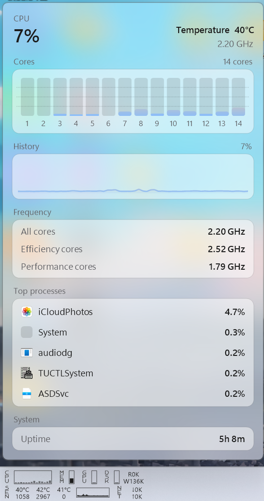
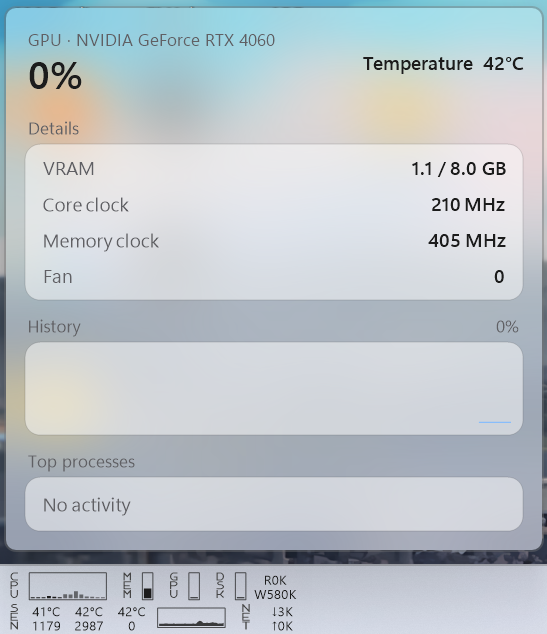
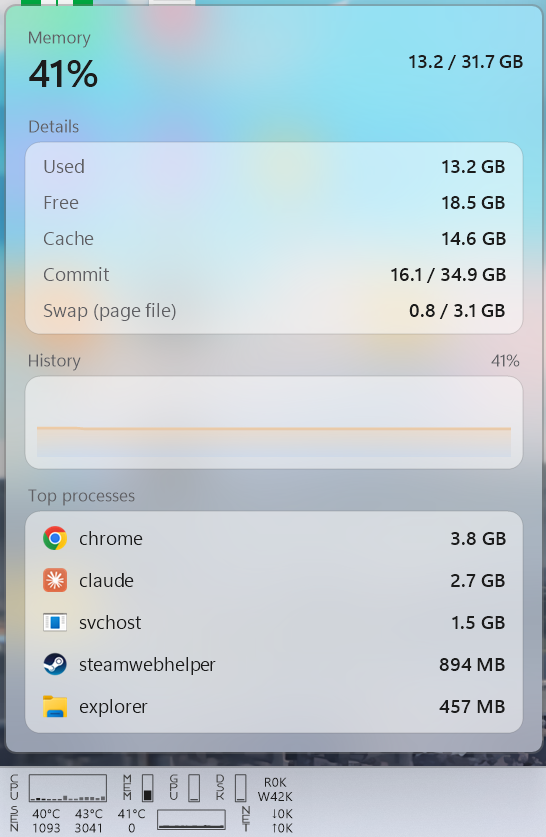
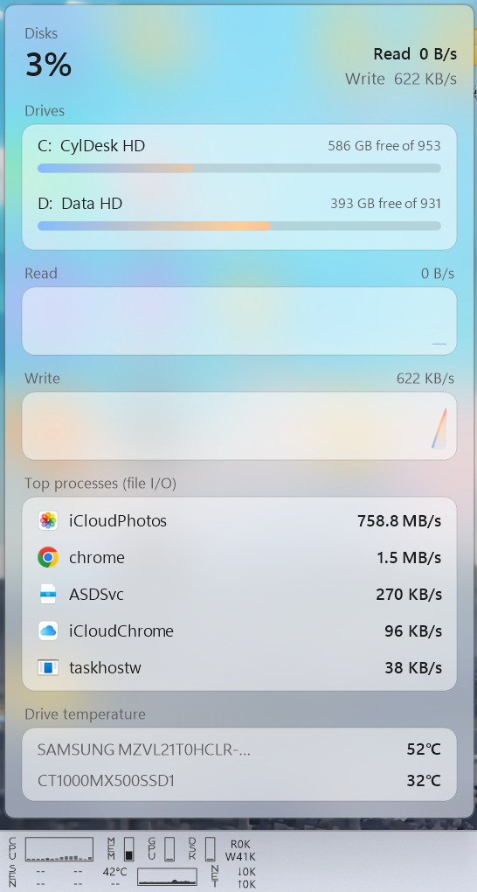
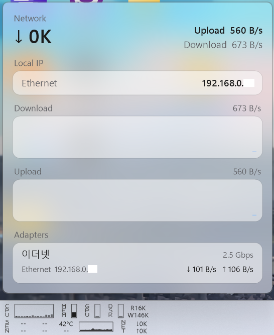
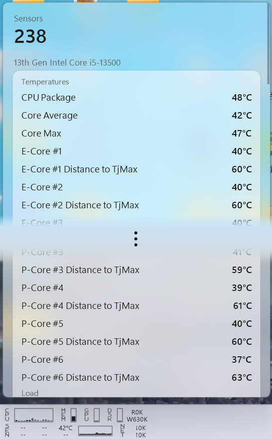
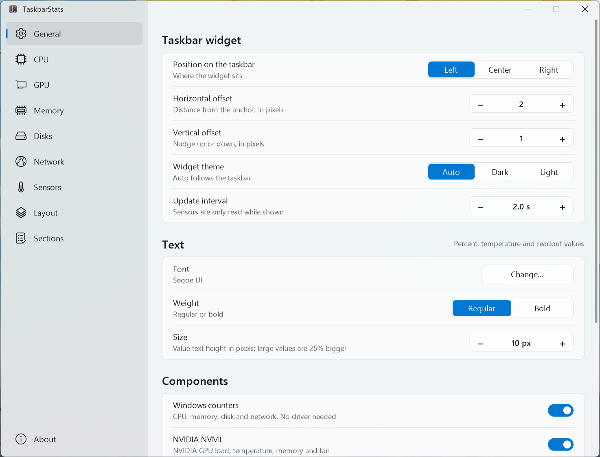
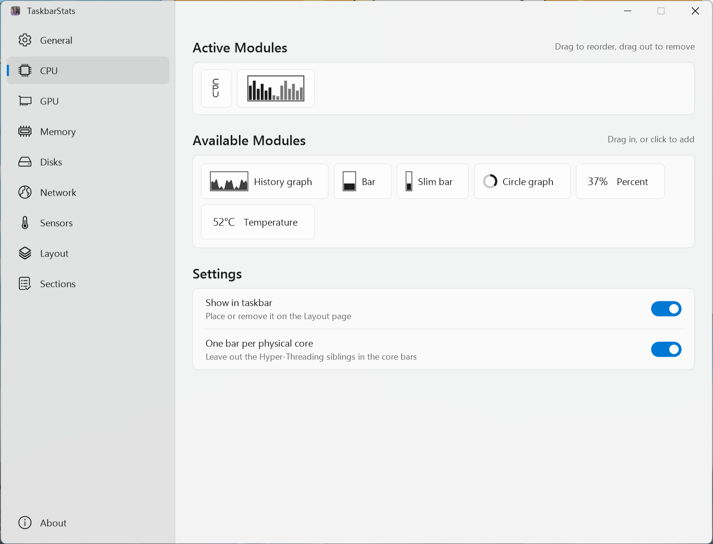
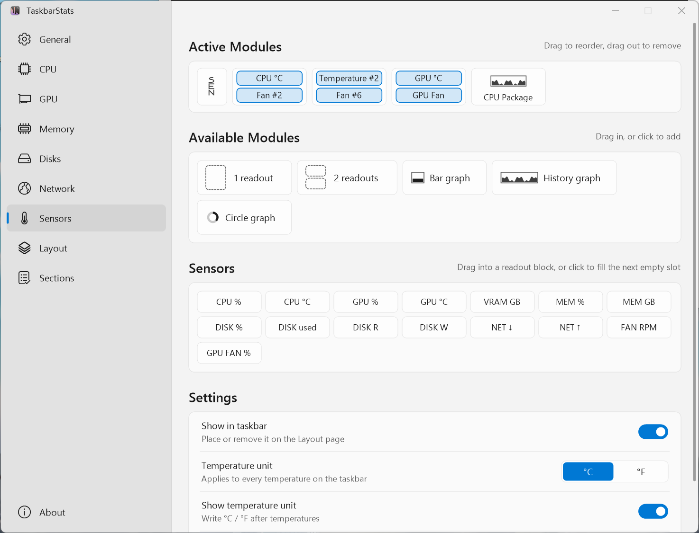
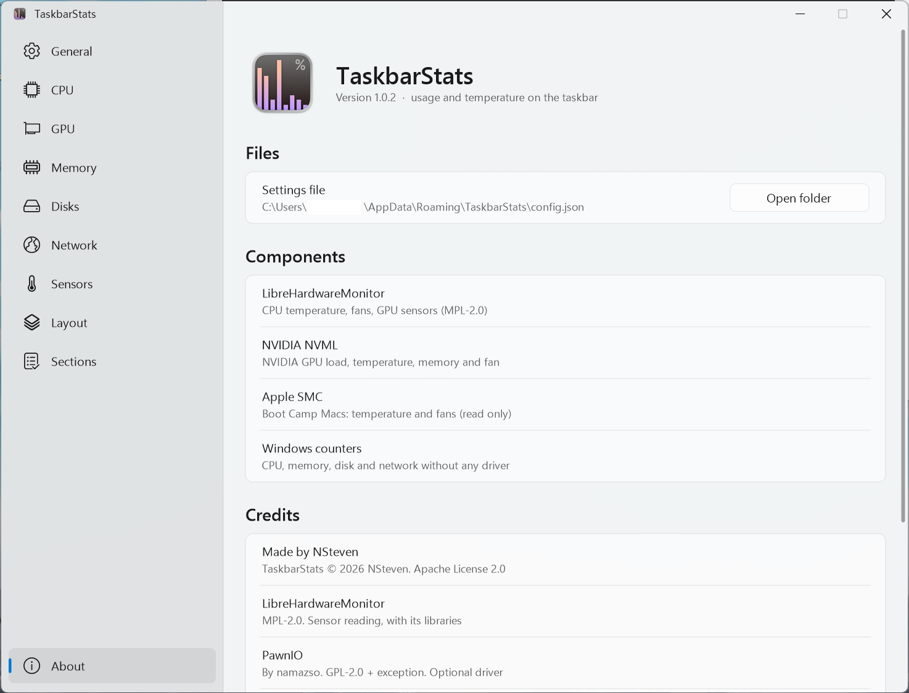

<p align="center">
  
</p>

<h1 align="center">TaskbarStats</h1>

<p align="center">
  A lightweight system monitor that lives on the Windows 11 taskbar.<br>
  CPU, GPU, memory, disks, network and every sensor you own — usage and temperature at a glance.
</p>

<p align="center">
  <b>English</b> · <a href="README_KR.md">한국어</a>
</p>

<p align="center">
  
</p>

## Introduction

TaskbarStats puts your system's vitals right on the Windows 11 taskbar. Pick what you want to see — usage, temperature, fan speed, or any sensor — and arrange it in two lanes. Click a module and a popup shows the details: per-core load, top processes, drives, adapters and every sensor. It reads hardware only while something is showing it, so it stays light. Boot Camp Macs are supported through Apple's SMC.

## Why I made this

macOS has many polished, feature-rich monitoring apps. On Windows, I couldn't find one I liked — they were either missing features or not flexible enough. So I built my own.

The idea comes from those macOS monitoring apps, and TaskbarStats is my take on bringing that experience to the Windows taskbar.

## Popups

Click a module on the taskbar to open its popup.

<table>
  <tr>
    <td align="center" valign="top"><a href="docs/cpu.png"></a><br><sub>CPU</sub></td>
    <td align="center" valign="top"><a href="docs/gpu.png"></a><br><sub>GPU</sub></td>
    <td align="center" valign="top"><a href="docs/mem.png"></a><br><sub>Memory</sub></td>
  </tr>
  <tr>
    <td align="center" valign="top"><a href="docs/dsk.png"></a><br><sub>Disks</sub></td>
    <td align="center" valign="top"><a href="docs/net.png"></a><br><sub>Network</sub></td>
    <td align="center" valign="top"><a href="docs/sen.png"></a><br><sub>Sensors</sub></td>
  </tr>
</table>

## Settings

<table>
  <tr>
    <td align="center" valign="top"><a href="docs/set-general.png"></a><br><sub>General</sub></td>
    <td align="center" valign="top"><a href="docs/set-cpu.png"></a><br><sub>Drag-and-drop modules</sub></td>
  </tr>
  <tr>
    <td align="center" valign="top"><a href="docs/set-sen.png"></a><br><sub>Pick any sensor</sub></td>
    <td align="center" valign="top"><a href="docs/set-about.png"></a><br><sub>About</sub></td>
  </tr>
</table>

## Features

- **Taskbar widget** with two lanes (top / bottom). Each module is built from items you choose: label, bar, slim bar, history graph, circle graph, core bars, percent, temperature, speeds, and your own sensor readouts.
- **Modules**: CPU, GPU, Memory, Disks, Network, Sensors, plus adjustable spacers.
- **Click popups** per module (CPU, GPU, Memory, Disks, Network, Sensors) with an Acrylic backdrop that follows the widget theme: per-core bars, history, frequency, top processes, drives, adapters and every sensor.
- **Sections page** in the settings turns each popup section on or off and sets how many processes are listed.
- **Any sensor on the taskbar**: pick any temperature, fan, load, clock or power sensor for a readout, bar, graph or ring.
- **Fluent settings window** (Mica) with drag-and-drop layout, font, size and weight, °C / °F, and rpm units.
- **Light on resources**: sensors are read only while something shows them, popups collect data only while open, and the idle footprint stays small.
- **Boot Camp Macs**: temperatures and fans through Apple's SMC driver (read only). Switched on automatically the first time the driver is detected.

## Install

1. Download `TaskbarStats-Setup-<version>.exe` from [Releases](../../releases). A portable zip is also provided.
2. Run the installer. It can download and install the [PawnIO](https://pawnio.eu) driver for you (recommended, selected by default) and register a startup task.

CPU and motherboard sensors need administrator rights and the PawnIO driver. Windows counters (usage, memory, disks, network) and NVIDIA GPU data work without either.

**Run as administrator** (settings → General) is on by default: when you open the app it asks for administrator rights, and with the startup task enabled it starts elevated without a UAC prompt.

## Build

Requires the .NET 10 SDK on Windows.

```
dotnet build -c Release
```

Installer (requires [Inno Setup 6](https://jrsoftware.org/isinfo.php)):

```
dotnet publish TaskbarStats.csproj -c Release -r win-x64 --self-contained -o publish
iscc /DAppVersion=1.0.0 /DSourceDir=..\publish installer\TaskbarStats.iss
```

Pushing a `v*` tag builds the installer and portable zip on GitHub Actions and attaches them to the release.

## License

Apache License 2.0 — Copyright 2026 NSteven. See [LICENSE](LICENSE) and [NOTICE](NOTICE).

Third-party software: [LibreHardwareMonitor](https://github.com/LibreHardwareMonitor/LibreHardwareMonitor) (MPL-2.0), HidSharp (Apache-2.0), System.Management (MIT), the Xanmono font (SIL OFL 1.1). The optional [PawnIO](https://pawnio.eu) driver is a separate project by namazso and is downloaded from its official source, never bundled. Licenses are in [`licenses/`](licenses/).

Apple, NVIDIA, AMD, Intel and Windows are trademarks of their owners. This project is not affiliated with them.
