<p align="center">
  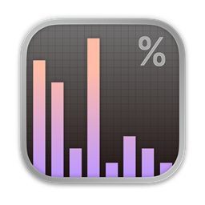
</p>

<h1 align="center">TaskbarStats</h1>

<p align="center">
  Windows 11 작업표시줄에 상주하는 가벼운 시스템 모니터.<br>
  CPU, GPU, 메모리, 디스크, 네트워크, 그리고 모든 센서의 사용량과 온도를 한눈에 보여 줍니다.
</p>

<p align="center">
  <a href="README.md">English</a> · <b>한국어</b>
</p>

<p align="center">
  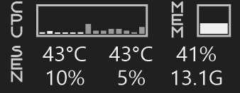
</p>

## 소개

TaskbarStats는 시스템 상태를 Windows 11 작업표시줄에 바로 보여 줍니다. 사용량, 온도, 팬 속도, 그 밖의 어떤 센서든 원하는 것을 골라 두 줄로 배치할 수 있습니다. 모듈을 클릭하면 코어별 부하, 상위 프로세스, 드라이브, 어댑터, 모든 센서 같은 상세 정보가 팝업으로 나타납니다. 화면에 보이는 것만 읽기 때문에 가볍고, 부트캠프 맥은 애플 SMC로 지원합니다.

## 만든 이유

macOS에는 예쁘고 기능이 다양한 모니터링 프로그램이 많습니다. 하지만 Windows에서는 기능이 부족하거나 자유도가 낮아서, 마음에 드는 프로그램을 찾지 못했습니다. 그래서 직접 만들게 되었습니다.

아이디어는 macOS의 모니터링 프로그램들에서 영감을 받았습니다.

## 팝업

작업표시줄의 모듈을 클릭하면 팝업이 열립니다.

<table>
  <tr>
    <td align="center" valign="top"><a href="docs/cpu.png">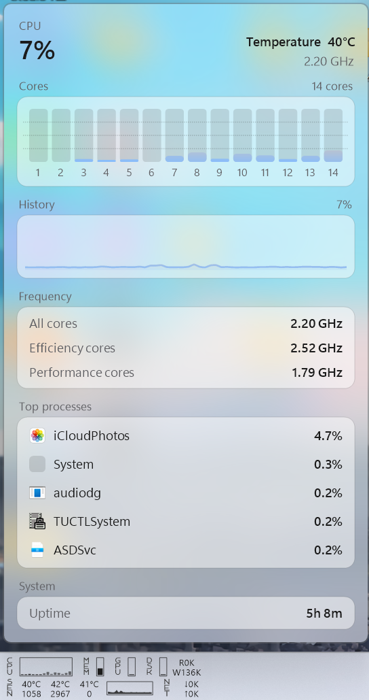</a><br><sub>CPU</sub></td>
    <td align="center" valign="top"><a href="docs/gpu.png">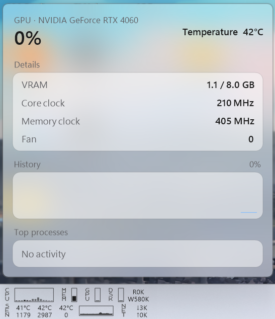</a><br><sub>GPU</sub></td>
    <td align="center" valign="top"><a href="docs/mem.png">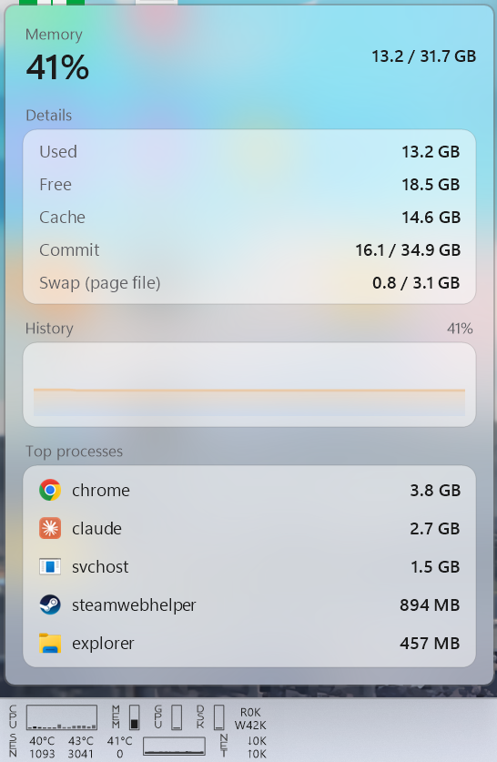</a><br><sub>메모리</sub></td>
  </tr>
  <tr>
    <td align="center" valign="top"><a href="docs/dsk.png">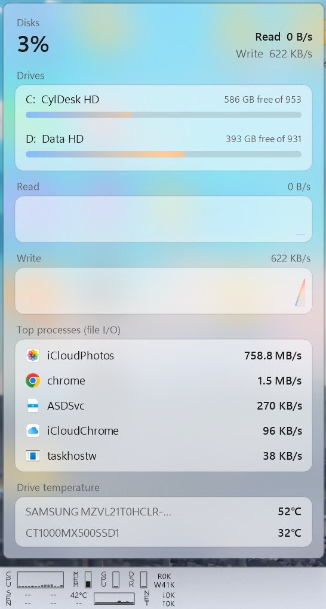</a><br><sub>디스크</sub></td>
    <td align="center" valign="top"><a href="docs/net.png">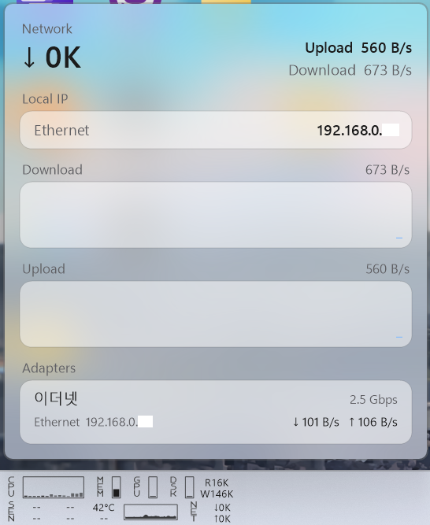</a><br><sub>네트워크</sub></td>
    <td align="center" valign="top"><a href="docs/sen.png">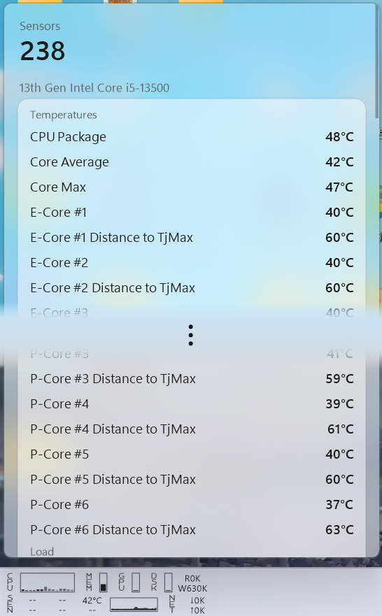</a><br><sub>센서</sub></td>
  </tr>
</table>

## 설정

<table>
  <tr>
    <td align="center" valign="top"><a href="docs/set-general.png">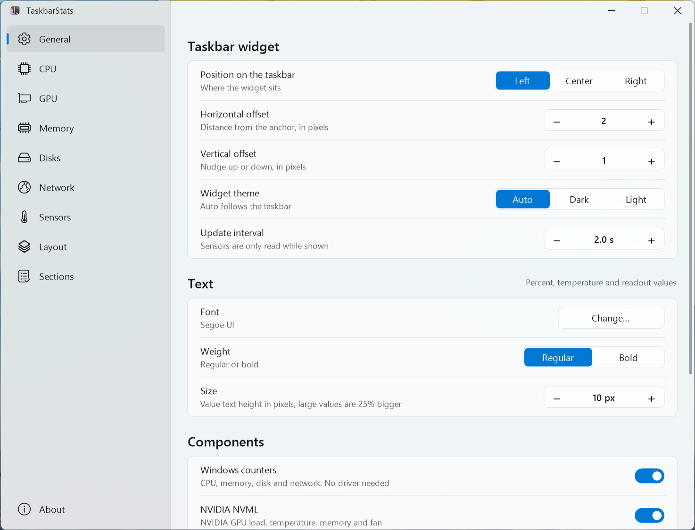</a><br><sub>일반</sub></td>
    <td align="center" valign="top"><a href="docs/set-cpu.png">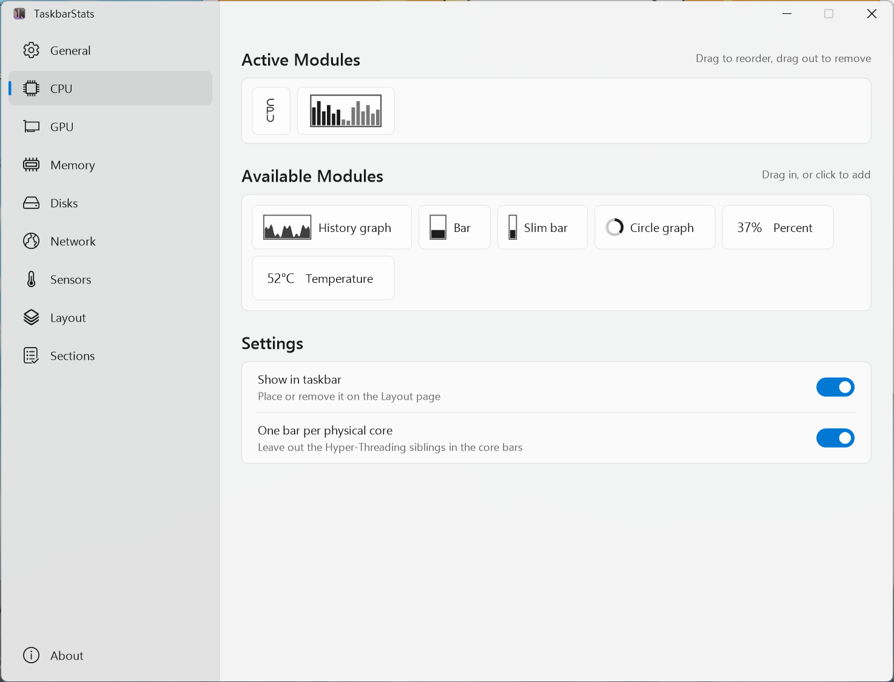</a><br><sub>드래그 앤 드롭 모듈 구성</sub></td>
  </tr>
  <tr>
    <td align="center" valign="top"><a href="docs/set-sen.png">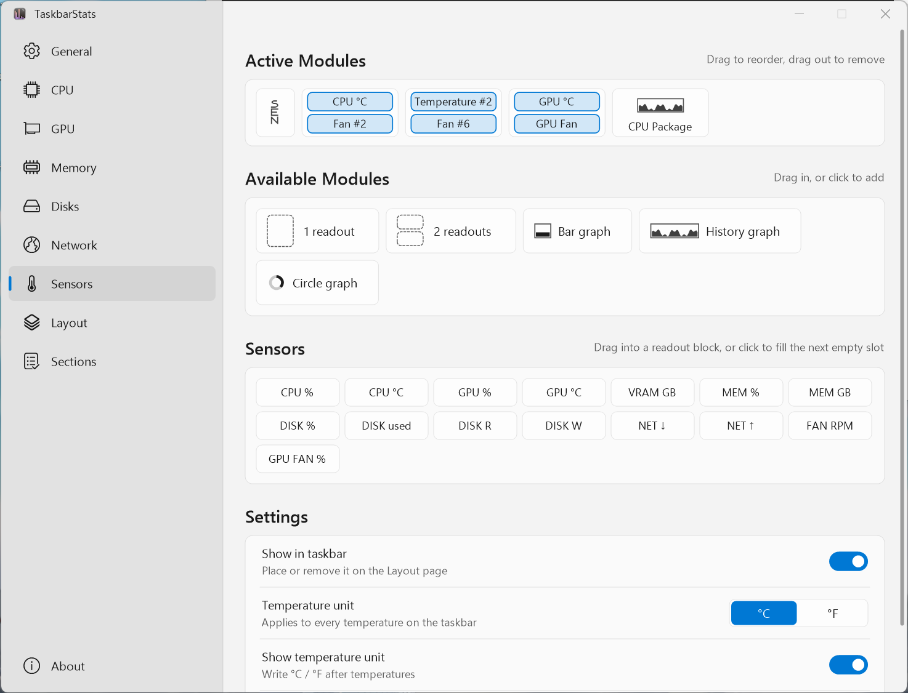</a><br><sub>원하는 센서 선택</sub></td>
    <td align="center" valign="top"><a href="docs/set-about.png">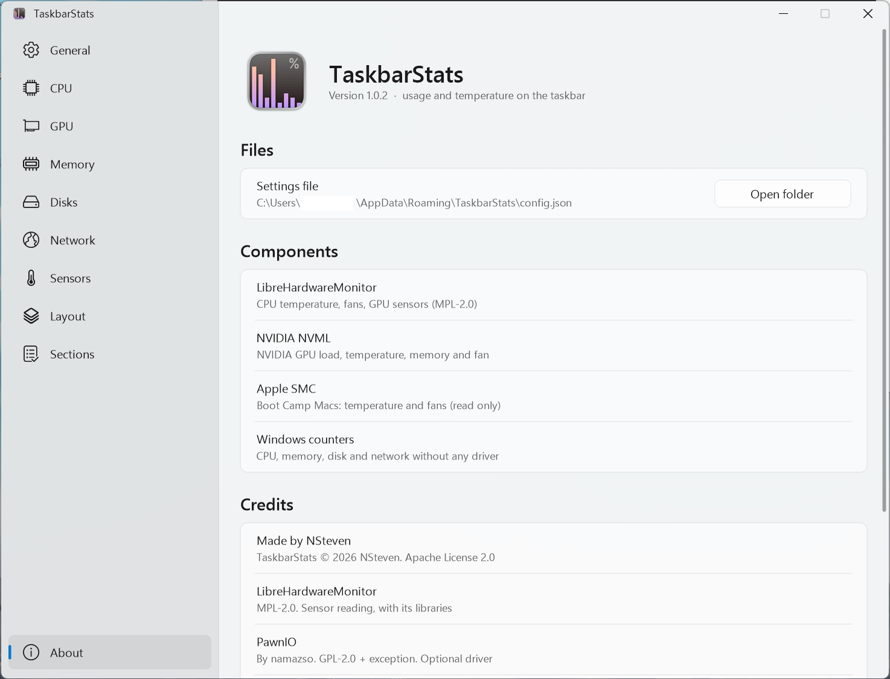</a><br><sub>정보</sub></td>
  </tr>
</table>

## 기능

- **작업표시줄 위젯**: 위/아래 두 줄 배치. 모듈마다 라벨, 막대, 얇은 막대, 히스토리 그래프, 원형 그래프, 코어 막대, 퍼센트, 온도, 속도, 원하는 센서 값 등을 골라 구성합니다.
- **모듈**: CPU, GPU, Memory, Disks, Network, Sensors, 그리고 간격을 조절하는 Space.
- **모듈별 클릭 팝업**(CPU, GPU, Memory, Disks, Network, Sensors): Acrylic 배경이며 위젯의 라이트/다크 테마를 따릅니다. 코어별 막대, 히스토리, 주파수, 상위 프로세스, 드라이브, 어댑터, 모든 센서를 보여 줍니다.
- **Sections 설정 페이지**: 팝업 섹션을 켜고 끄고, 프로세스 표시 개수를 정합니다.
- **어떤 센서든 작업표시줄에**: 온도, 팬, 부하, 클럭, 전력 센서를 골라 값, 막대, 그래프, 원형으로 표시합니다.
- **Fluent 설정 창**(Mica): 드래그 앤 드롭 레이아웃, 글꼴·크기·굵기, °C / °F, rpm 단위.
- **가벼움**: 화면에 쓰이는 센서만 읽고, 팝업은 열려 있는 동안에만 데이터를 수집하며, 대기 중 메모리 사용량이 작습니다.
- **부트캠프 맥**: 애플 SMC 드라이버로 온도와 팬을 읽습니다(읽기 전용). 드라이버가 처음 감지되면 자동으로 켜집니다.

## 설치

1. [Releases](../../releases)에서 `TaskbarStats-Setup-<버전>.exe`를 받습니다. 포터블 zip도 제공됩니다.
2. 설치 프로그램을 실행합니다. [PawnIO](https://pawnio.eu) 드라이버를 내려받아 설치하는 옵션(권장, 기본 선택)과 시작 작업 등록 옵션이 있습니다.

CPU와 메인보드 센서는 관리자 권한과 PawnIO 드라이버가 필요합니다. Windows 카운터(사용량, 메모리, 디스크, 네트워크)와 NVIDIA GPU 정보는 둘 다 없어도 동작합니다.

**Run as administrator**(설정 → General)는 기본으로 켜져 있습니다. 앱을 열면 관리자 권한을 요청하고, 시작 작업이 등록되어 있으면 UAC 프롬프트 없이 관리자로 시작합니다.

## 빌드

Windows와 .NET 10 SDK가 필요합니다.

```
dotnet build -c Release
```

설치 프로그램은 [Inno Setup 6](https://jrsoftware.org/isinfo.php)이 필요합니다.

```
dotnet publish TaskbarStats.csproj -c Release -r win-x64 --self-contained -o publish
iscc /DAppVersion=1.0.0 /DSourceDir=..\publish installer\TaskbarStats.iss
```

`v*` 태그를 푸시하면 GitHub Actions가 설치 프로그램과 포터블 zip을 만들어 릴리스에 첨부합니다.

## 안내

> [!NOTE]
> TaskbarStats는 제가 쓰려고 만든 개인 취미 프로젝트입니다. 버그가 있을 수 있고 다른 하드웨어에서는 다르게 동작할 수 있으며, 정상 동작, 센서 값의 정확성, 문제 수정을 보장하지 않습니다. 관리자 권한으로 실행되고 선택적으로 PawnIO 드라이버를 설치하므로, 사용에 따른 책임은 사용자에게 있습니다. 개발과 테스트는 Intel + NVIDIA PC와 AMD Radeon 그래픽의 부트캠프 맥(온도 표시 확인)에서 했으며, 그 외 하드웨어는 검증하지 못했습니다. Apache License 2.0에 따라 어떠한 보증 없이 "있는 그대로" 제공됩니다.

## 라이선스

Apache License 2.0 — Copyright 2026 NSteven. [LICENSE](LICENSE)와 [NOTICE](NOTICE)를 참고하세요.

서드파티: [LibreHardwareMonitor](https://github.com/LibreHardwareMonitor/LibreHardwareMonitor)(MPL-2.0), HidSharp(Apache-2.0), System.Management(MIT), Xanmono 글꼴(SIL OFL 1.1). 선택 사항인 [PawnIO](https://pawnio.eu) 드라이버는 namazso의 별도 프로젝트이며 공식 배포처에서 내려받고, 이 저장소에 포함하지 않습니다. 라이선스 전문은 [`licenses/`](licenses/)에 있습니다.

Apple, NVIDIA, AMD, Intel, Windows는 각 소유자의 상표이며, 이 프로젝트는 그들과 관련이 없습니다.
